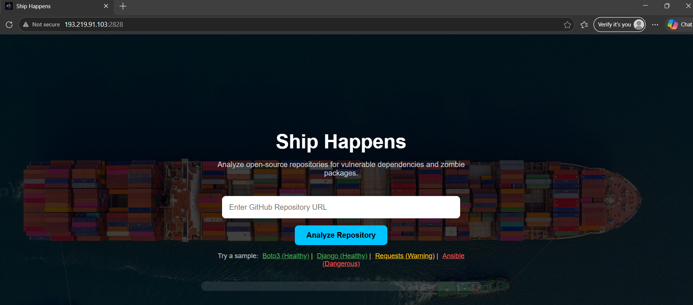
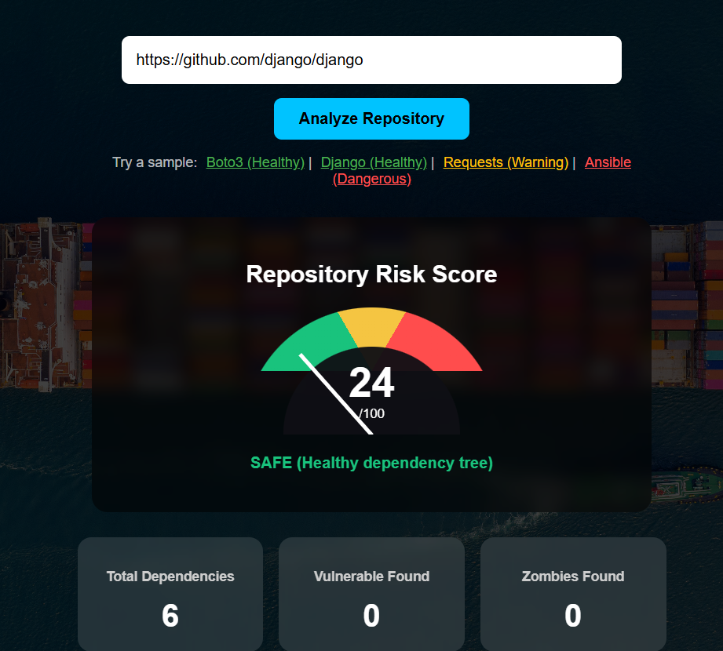
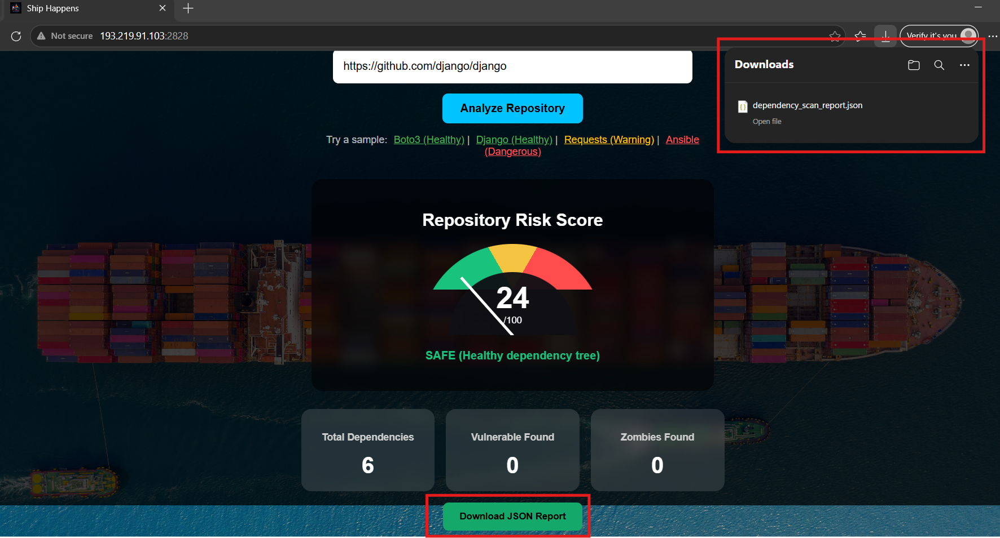

# MICAC_SoA_2026_SH
### Project Name: Ship Happens
### Authors and Acknowledgment
- Ariana Sofia Domingues Vaz Silva Alves
- Greivin Sanchez Garita
- Juan Luis Torres Ramos

## Project Overview
The primary objective of this framework is to mitigate risks within the Software Supply Chain by identifying "Zombie Packages". These are defined as dependencies that, despite having no documented vulnerabilities (CVEs), have been abandoned by their maintainers. These "stale" components represent a critical security blind spot, as they are unlikely to receive patches for future exploits.

To address this, the system implements a risk heuristic that evaluates every dependency on a scale of 0 to 100. This score determines if a package has reached a "zombie state" based on four safety pillars:

* **Vulnerability Exposure:** Cross-referencing with the OSV (Open Source Vulnerability) database.
* **Maintenance Vitality:** Detection of project stagnation through commit frequency analysis.
* **Maintenance Redundancy:** Calculating the "Bus Factor" to identify dependencies reliant on a single point of failure.
* **Community Health:** Assessing issue neglect as a lead indicator of package abandonment.

A dependency is formally classified as a Zombie Package if it exceeds the 100-point risk threshold or carries an explicit deprecation flag. Consequently, the final repository grade (**Safe**, **Warning**, or **Dangerous**) is dictated by the highest risk score found within its dependency tree.

## Repository Structure
The repository is organized into the following areas:

### Source Code
* `dependency_reader/`: Core backend analysis engine.
* `webapp/`: Frontend interface for data visualization.

### Project Management
* `Docs/Workflow.md`: Documentation of Git protocols and team collaboration standards.
* `Docs/Meeting_minutes.md`: Chronological record of project sessions and decisions.

### Documentation
The report for this project is maintained and updated via Overleaf [here](https://www.overleaf.com/1311323137tcwpffgfycgw#b24c23).

## Prerequisites

Before deploying to another computer, ensure the following are installed:
- [Docker](https://docs.docker.com/get-docker/)
- [Docker Compose](https://docs.docker.com/compose/install/) (included in Docker Desktop)
- Make sure ports `8080` and `443` are free.

## Deployment Instructions

### Docker Deployment

This directory contains the necessary configuration files to deploy the Dependency Reader stack using Docker Compose.

Self signed with HTTPS instead of HTTP with port 8080 

The stack consists of three services:
* **Backend:** FastAPI scanner service (`api.py`) running on Python Uvicorn.
* **Frontend:** Flask web application (`app.py`) running on Gunicorn.
* **Nginx:** Reverse proxy that routes traffic to the frontend and backend, and handles HTTPS.

1. **Clone the Repository**  
   Copy the entire `micac_soa_2026_sh` project folder to the target computer.
    ```bash
    git clone https://git.mif.vu.lt/juto2015/micac_soa_2026_sh.git
    ```

2. **Configure Environment Variables**  
   Create or modify the `.env` file in the root of the project (two folders up from this deployment folder: `../../.env`).
   ```env
   GITHUB_TOKEN=your_github_personal_access_token
   ALLOWED_ORIGINS=http://localhost:8080,https://localhost
   ```
   *(Note: The `GITHUB_TOKEN` is highly recommended to avoid GitHub API rate limits.)*

3. **Navigate to the Deployment Folder**  
   Open a terminal and navigate to this folder:
   ```bash
   cd source_code/deployment
   ```

4. **Generate SSL Certificates (Required for HTTPS)**  
   Since we use HTTPS, you must generate a new self-signed certificate on the target machine:
   ```bash
   mkdir -p certs
   openssl req -x509 -nodes -days 365 -newkey rsa:2048 -keyout certs/key.pem -out certs/cert.pem -subj "/CN=localhost"
   ```

5. **Start the Stack**  
   Run the following command to build and start the containers in detached mode:
   ```bash
   docker compose up -build -d
   ```

6. **Access the Application**  
   To find your machine's IP address, run:
   ```bash
   hostname -I | awk '{print $1}'
   ```
   The application will be available securely at that IP address:
   - **Website:** `https://<YOUR_IP_ADDRESS>/`
   - **API Docs:** `https://<YOUR_IP_ADDRESS>/api/docs`
   
   *Note: Because you are using a self-signed certificate, your browser will show a "Not Secure" warning. Click **Advanced -> Proceed (Accept Risk)** to view the page.*

7. **Usage**
    The application frontend will show a page like the one below: 
    
    In the search bar the user can easily copy and paste one of the following url samples to test the application: 
    - https://github.com/boto/boto3  
    - https://github.com/axios/axios 
    - https://github.com/gin-gonic/gin 
    - https://github.com/ansible/ansible 

    Or use one of the suggested ones bellow the "Analyze Repository" blue button.

    After clicking the "Analyze Repository" button the user will get a summary of the repository health status.

    
    
    Furthemore, the user will be able to download a .json file report with the findings.
    
    


 
## Useful Commands

- **View Logs:**
  ```bash
  docker compose logs -f
  ```
- **Stop the Stack:**
  ```bash
  docker compose down
  ```
- **Rebuild after Code Changes:**
  ```bash
  docker compose up --build -d
  ```
